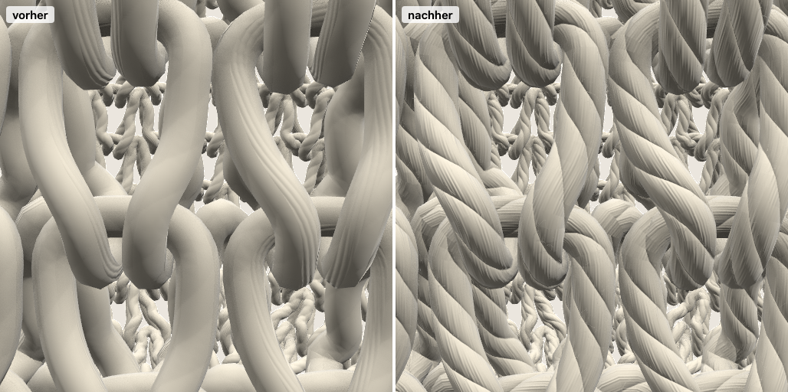
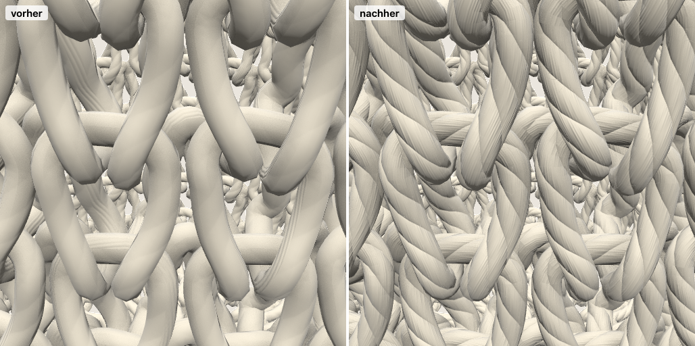
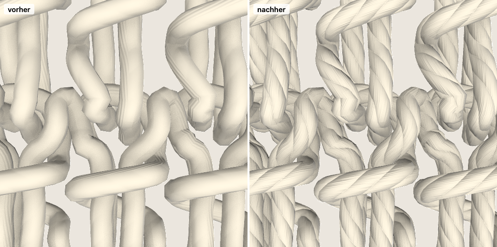
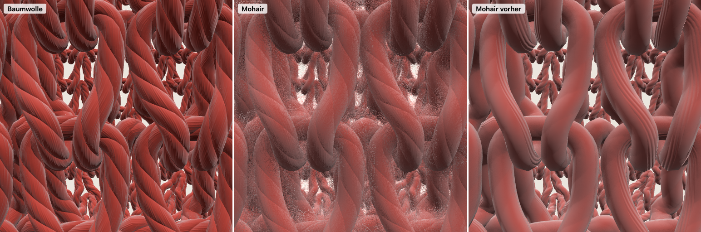

Gerendert mit dem Web-Viewer im Snapshot-Modus (`/?snapshot=<key>&view=front`, Kamera per
Playwright herangezoomt bzw. um 180° gedreht), Garn Baumwolle, 2 mm, Nadel 3,5 mm.

Stb-Quadrat (Stück 6), links von vorn, rechts von hinten (die Rückseite liegt im Schatten der
Studiobeleuchtung). Weil gewendet wird, zeigt jede zweite Reihe ihre Vorderseite:

- **V-Köpfe** oben an jeder Masche als Bogen des vorderen Maschenglieds; zusammen mit dem
  hinteren Glied und dem Einstich der nächsten Reihe bilden sie die Kettenreihe zwischen den Reihen.
- **Schaft** aus vier Strängen, schmaler als der V-Kopf, daher die für Stäbchen typischen Lücken
  zwischen den Schäften.
- **Umschlag**: eine Windung um den ganzen Schaft, auf den Reihen mit der Vorderseite zur Kamera
  als schräger Steg, auf den Reihen mit der Rückseite als flacherer Steg.
- Wende-Lm (3) steigen außen an der Kante als kleine Kette hoch, nicht mehr auf dem Schaft der
  ersten Masche; Luftmaschenanschlag unten als Kette.
- Faden durchgehend; an den Kontaktstellen keine sichtbaren Durchdringungen (A5 gemessen:
  max. 0,01–0,02 Garnradien).

Links hStb-Quadrat, rechts DStb-Quadrat (beide von vorn). hStb: kurzer Schaft mit einer Windung;
auf den Reihen mit der Rückseite zur Kamera liegt der waagrechte Steg des dritten Maschenglieds
(Camel-Bump) direkt unter dem V-Kopf, auf den anderen der schräge vordere Teil der Windung.
DStb: langer Schaft mit **zwei** Windungen übereinander, Wende-Lm (4) außen an der Kante.

Abnahmen (Stb2zus./DStb2zus.) wurden mit dem Entwicklungs-Renderer geprüft: aus jeder
Elternmasche ein halber Schaft mit eigener Windung (DStb: zwei), oben unter einem V-Kopf
vereint. Die Stb-Scheibe aus dem Magic Ring zeigt strahlenförmige Schäfte mit Windungen; die
Mitte ist dicht, der Ring bleibt geschlossen.

### Rendering: Ply-Normal-Map, Faserflaum, LOD (Task 14)

Web-Viewer, Snapshot-Modus mit Metal-GPU, Kamera per `__stitchcraft.closeUp(22)` 22 mm vor die Masche in
Bildmitte gesetzt (vorher und nachher dieselbe Kamera), Garn 2 mm, Nadel 3,5 mm.

- **Ply:** prozedurale Normal-Map im Tangentialraum (`web/src/viewer/ply.ts`): vier runde Plies, Helixwinkel
  ≈ 37°, darauf feine Fasern längs des Garns; Stärke je Material (`MATERIAL_LOOK.normalScale`). Vorher lag die
  Bump-Map über der Naht der Tube rückwärts gestaucht (Streifenbündel an einer Seite), das ist behoben (Ring mit
  Nahtvertex). Baumwolle liest sich jetzt als gezwirntes Garn statt als glatter Schlauch; die Rillen sind eher
  kräftig (Kordel-Anmutung) – Kalibrierung gegen Fotos steht noch aus.
- **Faserflaum** (`fuzz.ts`): bis zu sechs transluzente Schalen über der Tube, Fasern steigen von Schale zu Schale
  auf; Mohair deutlich (Halo, füllt die Lücken weich), Baumwolle dezent, Acryl aus. Schalter „Faserflaum“ im
  Popover „Werkzeuge“. Mohair wirkt damit flauschig; der Kern zeigt die Plies noch, echtes Mohair verdeckt sie
  stärker.
- **LOD** (`lod.ts`): Garn in Abschnitte zu 2 048 Punkten geteilt, je Abschnitt nach Garndicke in Gerätepixeln:
  ab 48 px 12 Seiten + volle Schalen, ab 10 px 8 Seiten + halbe Schalen auf gröberer Tube, darunter 4 Seiten,
  jeder zweite Punkt, ohne Flaum (Hysterese gegen Flackern). Stücke bis 100 000 Garnpunkte (≈ 800 Maschen)
  bleiben immer mindestens „nah“. Abschnitte außerhalb des Bildes werden nicht gezeichnet.
- **Determinismus:** keine Zufallszahlen ohne festen Seed; zwei Snapshots derselben Eingabe sind pixelgleich
  (`snapshot.e2e.ts`), das MCP-PNG (`session.py --require-png`, SwiftShader) ebenfalls byte-gleich.

### A9 Viewer-FPS

`web/e2e/fps.e2e.ts`, Stück mit 4 896 Maschen (geschlossene Röhre, 656 887 Garnpunkte), Apple M4 (MacBook),
Chromium headless mit `--use-angle=metal`, ohne Bildratenbegrenzung (`--disable-gpu-vsync
--disable-frame-rate-limit`), 1440 × 900 bei Pixelverhältnis 2, Median über 5 s.

| Material | Totale | Nahaufnahme (30 mm) |
|---|---|---|
| Baumwolle | 89,9 FPS | 64,5 FPS |
| Mohair | 90,5 FPS | 43,5 FPS |

Gegenprobe mit dem Produktions-Build (Docker, nginx auf :8080), gleiche Flags, Abstand zur Masche in Bildmitte:

| Material | Totale | 30 mm | 90 mm | 180 mm |
|---|---|---|---|---|
| Baumwolle | 91,6 | 61,4 | 57,9 | 54,6 |
| Mohair | 91,8 | 44,1 | 39,8 | 39,5 |

Alle Werte ≥ 30 FPS: A9 Viewer erfüllt (auf M4; ältere M-Chips haben weniger Reserve, am knappsten Mohair
bei mittlerem Abstand).

Vor Task 14 (ein Mesh, 8 Seiten, alle Punkte) lag dasselbe Stück bei ≈ 61 FPS (Totale) und ≈ 44 FPS
(Mausrad-Zoom) ohne Flaum. Mit Bildratenbegrenzung (60 Hz) zeigt der Viewer in Totale und Nahaufnahme 60 FPS
(Baumwolle). Linux-CI überspringt die Messung (SwiftShader ist kein gültiger Messort).
