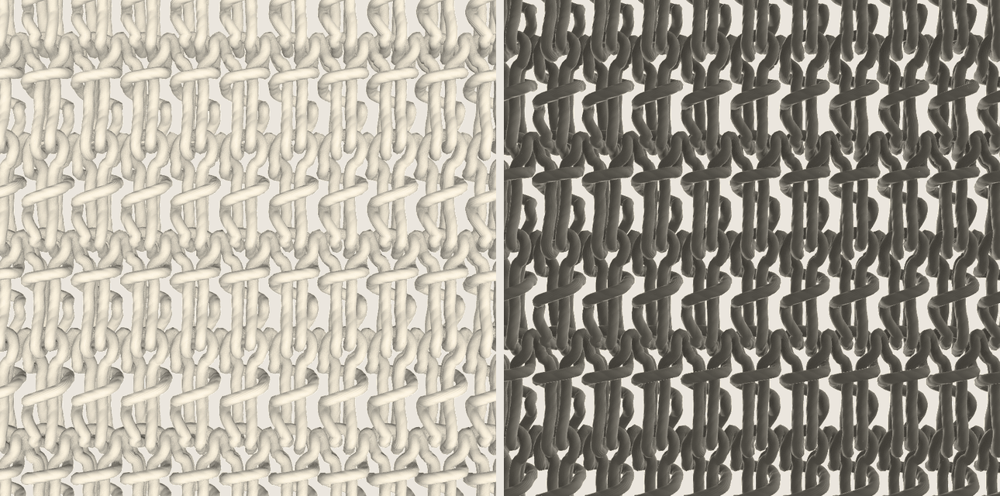
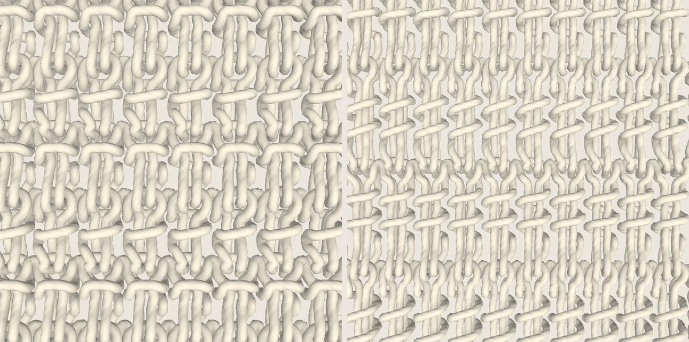

Gerendert mit dem Web-Viewer im Snapshot-Modus (`/?snapshot=<key>&view=front`, Kamera per
Playwright herangezoomt bzw. um 180° gedreht), Garn Baumwolle, 2 mm, Nadel 3,5 mm.

Stb-Quadrat (Stück 6), links von vorn, rechts von hinten (die Rückseite liegt im Schatten der
Studiobeleuchtung). Weil gewendet wird, zeigt jede zweite Reihe ihre Vorderseite:

- **V-Köpfe** oben an jeder Masche als Bogen des vorderen Maschenglieds; zusammen mit dem
  hinteren Glied und dem Einstich der nächsten Reihe bilden sie die Kettenreihe zwischen den Reihen.
- **Schaft** aus vier Strängen, schmaler als der V-Kopf, daher die für Stäbchen typischen Lücken
  zwischen den Schäften.
- **Umschlag**: eine Windung um den ganzen Schaft, auf den Reihen mit der Vorderseite zur Kamera
  als schräger Steg, auf den Reihen mit der Rückseite als flacherer Steg.
- Wende-Lm (3) steigen außen an der Kante als kleine Kette hoch, nicht mehr auf dem Schaft der
  ersten Masche; Luftmaschenanschlag unten als Kette.
- Faden durchgehend; an den Kontaktstellen keine sichtbaren Durchdringungen (A5 gemessen:
  max. 0,01–0,02 Garnradien).

Links hStb-Quadrat, rechts DStb-Quadrat (beide von vorn). hStb: kurzer Schaft mit einer Windung;
auf den Reihen mit der Rückseite zur Kamera liegt der waagrechte Steg des dritten Maschenglieds
(Camel-Bump) direkt unter dem V-Kopf, auf den anderen der schräge vordere Teil der Windung.
DStb: langer Schaft mit **zwei** Windungen übereinander, Wende-Lm (4) außen an der Kante.

Abnahmen (Stb2zus./DStb2zus.) wurden mit dem Entwicklungs-Renderer geprüft: aus jeder
Elternmasche ein halber Schaft mit eigener Windung (DStb: zwei), oben unter einem V-Kopf
vereint. Die Stb-Scheibe aus dem Magic Ring zeigt strahlenförmige Schäfte mit Windungen; die
Mitte ist dicht, der Ring bleibt geschlossen.
