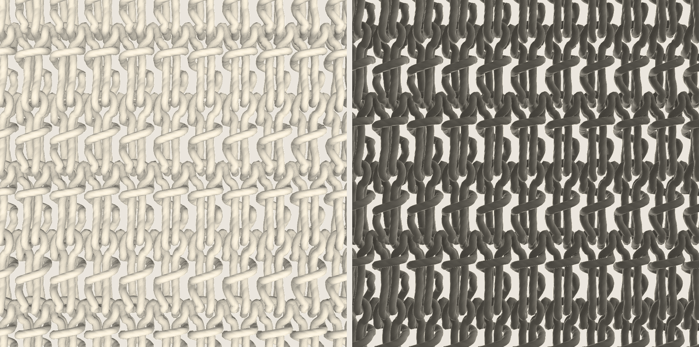
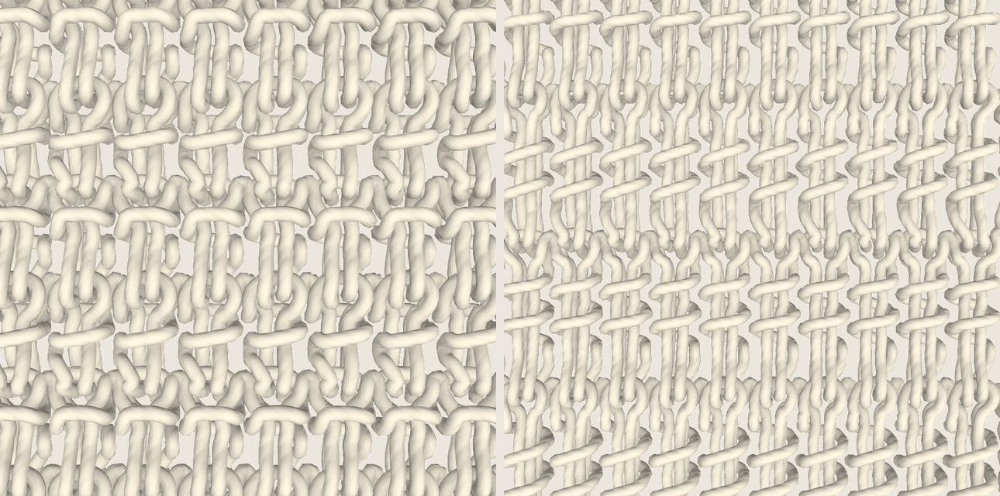

# M5-Abnahme: hStb, Stb und DStb

Stand: 2026-11-23 · erzeugt mit `uv run stitchcraft gate --milestone m5`

Referenzstück 6 (`tests/reference/6-dc-square`, de/en-US/en-UK) und die Teststücke hstb-quadrat, dstb-quadrat, stb-scheibe, stb-abnahmen (nur A4/A5). A7: Reihenabstand Stb/fM in 1.7–2.3, RMS-Abstand zur Ebene ≤ 5% der Breite.

| # | Status | Messwert |
|---|---|---|
| A3 | pass | `stitch counts and parents match: True; de/en-US/en-UK give the same IR, graph and yarn hash: True` |
| A4 | pass | `{'max gap / yarn radius': {'6-dc-square': -0.001, 'hstb-quadrat': 0.002, 'dstb-quadrat': 0.002, 'stb-scheibe': -0.0, 'stb-abnahmen': 0.002}}` |
| A5 | pass | `{'6-dc-square': {'max_depth_r': 0.01, 'affected': 0.0}, 'hstb-quadrat': {'max_depth_r': 0.0, 'affected': 0.0}, 'dstb-quadrat': {'max_depth_r': 0.0, 'affected': 0.0}, 'stb-scheibe': {'max_depth_r': 0.0, 'affected': 0.0}, 'stb-abnahmen': {'max_depth_r': 0.02, 'affected': 0.0}}` |
| A7 | pass | `{'row_pitch_dc_over_sc': 2.0, 'flat_rms_over_width': 0.0003}` |
| A8 | pass | `1 distinct hash(es) over 3 runs` |
| A9 | pass | `6-dc-square 0.53 s, 3-sphere 4.96 s on this machine` |

Nicht erfüllt: –

## Korpus: A5 der Anleitungen mit hStb/Stb/DStb (informativ, nicht gegatet)

| Anleitung | max. Eindringtiefe / Garnradius | betroffene Paare | A5 |
|---|---|---|---|
| de/05-muschelreihe | 0.0 | 0.0 | ok |
| de/09-staebchen-quadrat | 0.0 | 0.0 | ok |
| de/10-hstb-muetze | 0.0 | 0.0 | ok |
| de/13-v-maschen | 0.0 | 0.0 | ok |
| en-UK/03-htr-rounds | 0.0 | 0.0 | ok |
| en-UK/04-tr-square | 0.0 | 0.0 | ok |
| en-UK/05-slip-stitches | 0.0 | 0.0 | ok |
| en-UK/06-shells | 0.0 | 0.0 | ok |
| en-UK/09-dtr-row | 0.0 | 0.0 | ok |
| en-UK/10-tr2tog | 0.0 | 0.0 | ok |
| en-UK/11-v-stitch | 0.0 | 0.0 | ok |
| en-US/05-shells | 0.0 | 0.0 | ok |
| en-US/07-hdc-hat | 0.0 | 0.0 | ok |
| en-US/08-dc-decreases | 0.01 | 0.0 | ok |
| en-US/12-ambiguous-dc | 0.01 | 0.0 | ok |

## Sichtprüfung

Gerendert mit dem Web-Viewer im Snapshot-Modus (`/?snapshot=<key>&view=front`, Kamera per
Playwright herangezoomt bzw. um 180° gedreht), Garn Baumwolle, 2 mm, Nadel 3,5 mm.

Stb-Quadrat (Stück 6), links von vorn, rechts von hinten (die Rückseite liegt im Schatten der
Studiobeleuchtung). Weil gewendet wird, zeigt jede zweite Reihe ihre Vorderseite:

- **V-Köpfe** oben an jeder Masche als Bogen des vorderen Maschenglieds; zusammen mit dem
  hinteren Glied und dem Einstich der nächsten Reihe bilden sie die Kettenreihe zwischen den Reihen.
- **Schaft** aus vier Strängen, schmaler als der V-Kopf, daher die für Stäbchen typischen Lücken
  zwischen den Schäften.
- **Umschlag**: eine Windung um den ganzen Schaft, auf den Reihen mit der Vorderseite zur Kamera
  als schräger Steg, auf den Reihen mit der Rückseite als flacherer Steg.
- Wende-Lm (3) steigen außen an der Kante als kleine Kette hoch, nicht mehr auf dem Schaft der
  ersten Masche; Luftmaschenanschlag unten als Kette.
- Faden durchgehend; an den Kontaktstellen keine sichtbaren Durchdringungen (A5 gemessen:
  max. 0,01–0,02 Garnradien).

Links hStb-Quadrat, rechts DStb-Quadrat (beide von vorn). hStb: kurzer Schaft mit einer Windung;
auf den Reihen mit der Rückseite zur Kamera liegt der waagrechte Steg des dritten Maschenglieds
(Camel-Bump) direkt unter dem V-Kopf, auf den anderen der schräge vordere Teil der Windung.
DStb: langer Schaft mit **zwei** Windungen übereinander, Wende-Lm (4) außen an der Kante.

Abnahmen (Stb2zus./DStb2zus.) wurden mit dem Entwicklungs-Renderer geprüft: aus jeder
Elternmasche ein halber Schaft mit eigener Windung (DStb: zwei), oben unter einem V-Kopf
vereint. Die Stb-Scheibe aus dem Magic Ring zeigt strahlenförmige Schäfte mit Windungen; die
Mitte ist dicht, der Ring bleibt geschlossen.
