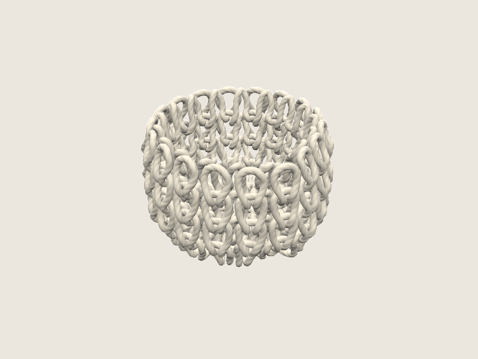

# MCP in Claude Code einbinden

Der MCP-Server (`services/mcp`, Paket `stitchcraft-mcp`) macht den Kern als Werkzeuge für Claude Code,
Claude Desktop und andere MCP-Clients nutzbar: Anleitungen prüfen, parsen, als 3D-Modell simulieren
und als PNG ansehen. Er nutzt denselben Cache wie die API.

## Start-Varianten

| Variante | Befehl | Hinweis |
|---|---|---|
| lokal, stdio | `uv run stitchcraft-mcp stdio` | Python 3.14 und `uv sync` im Repo nötig; kein PNG (siehe unten) |
| Docker, stdio | `docker compose run --rm -i mcp stdio` | `-i` und das Argument `stdio` sind nötig |
| Streamable HTTP | `docker compose up -d` oder `uv run stitchcraft-mcp http --port 8765` | `http://localhost:8765/mcp` |

## Einbinden

Claude Code (im Projektordner oder mit absoluten Pfaden):

```sh
# stdio über uv
claude mcp add stitchcraft -- uv run --directory /pfad/zu/StitchCraft stitchcraft-mcp stdio

# stdio über Docker
claude mcp add stitchcraft -- docker compose -f /pfad/zu/StitchCraft/compose.yaml run --rm -i mcp stdio

# Streamable HTTP (der Stack läuft per `docker compose up -d`)
claude mcp add --transport http stitchcraft http://localhost:8765/mcp
```

Mit `--scope project` landet der Eintrag in `.mcp.json` im Projekt; dieselbe Datei lässt sich von
Hand schreiben:

```json
{
  "mcpServers": {
    "stitchcraft": {
      "command": "uv",
      "args": ["run", "--directory", "/pfad/zu/StitchCraft", "stitchcraft-mcp", "stdio"]
    },
    "stitchcraft-http": { "type": "http", "url": "http://localhost:8765/mcp" }
  }
}
```

Claude Desktop: denselben `command`/`args`-Eintrag unter `mcpServers` in
`claude_desktop_config.json` eintragen (stdio). In Claude Code zeigt `/mcp`, ob der Server verbunden ist.

## Werkzeuge

| Werkzeug | Eingabe | Ausgabe |
|---|---|---|
| `validate_pattern` | `text`, `dialect` (`de`, `en-US`, `en-UK`, `auto`), `ui_locale` (`de`, `en`), `params?` (`yarn_mm`, `material`, …), `pace?` (`anfaenger`, `geuebt` (Standard), `schnell`), `stitches_per_minute?` | erkannter Dialekt, `ok`, Diagnosen mit Zeile/Spalte und Meldung, Soll/Ist je Runde/Reihe, `time_estimate` (Häkelzeit, siehe unten) |
| `parse_pattern` | `text`, `dialect` | kanonische Zwischendarstellung (IR) als JSON |
| `render_preview` | `text`, `dialect`, `params?` (Garn, Nadel, Maschenprobe, Füllung, `material`, `color`, …), `view?` (`front`, `side`, `top`, `iso`), `ui_locale` | strukturierte Daten: `id`, `cached`, `resources`, `stats` (Maschen, Maße in cm, Garnlänge), `diagnostics`, `notes`; dazu ein PNG als Bildinhalt (`image/png`), wenn der Snapshot-Dienst läuft |
| `list_stitches` | `dialect` | Maschenbibliothek, Makros und Vokabular des Dialekts |

`time_estimate` ist die geschätzte Häkelzeit: `{seconds_low, seconds_high, per_row: [{number, kind,
seconds}]}`. Sie ist eine Summe über die Maschen mit den Werten aus `data/timing.toml` (Sekunden je
Maschentyp, Zuschläge für Zu-/Abnahmen, je Runde/Reihe, je Farbwechsel und den Magic Ring), mal Tempo
und einem kleinen Faktor für Garnstärke und Material aus `params`. Die Spanne ist ±25 %, `per_row`
enthält den Mittelwert je Runde/Reihe. `stitches_per_minute` (feste Maschen pro Minute, selbst
gemessen) ersetzt Tempo und Garnfaktor; andere Maschen behalten ihr Verhältnis zur festen Masche.
Ausstopfen, Zusammennähen und Fäden vernähen sind nicht enthalten. Leere oder zu große Anleitungen
liefern `null`. Die API (`POST /api/v1/validate`) nimmt dieselben Felder und liefert dieselbe Zahl.

Ergebnisse von `render_preview` liegen im Cache und werden nach Inhalt wiedererkannt: Ein zweiter Aufruf
mit derselben Anleitung rechnet nicht neu. Die Garnfarbe gehört bewusst nicht zum Schlüssel, ändert aber das PNG.

## Resources

| URI | Inhalt |
|---|---|
| `stitchcraft://previews/{key}/model.glb` | glTF-Modell (`model/gltf-binary`) |
| `stitchcraft://previews/{key}/shape.json` | Maschenpositionen und Metadaten |
| `stitchcraft://previews/{key}/{color}/{view}.png` | PNG-Snapshot; `color` sind 6 Hex-Ziffern klein ohne `#`, z. B. `efe6d2/front.png` |

`{key}` ist die `id` aus `render_preview`. Eine PNG-Resource gibt es nur, wenn `render_preview` sie mit
dieser Farbe und Ansicht erzeugt hat.

## Snapshot-Dienst (PNG)

Das PNG rendert ein eigener Dienst (`services/snapshot`, Node + Playwright/Chromium) aus derselben
Viewer-Seite wie die Web-Vorschau (`/?snapshot=<key>&view=…`). Er liegt im Compose-Profil `snapshot`,
weil Software-WebGL (SwiftShader) unter Apple Silicon langsam sein kann, und hat keinen veröffentlichten Port:

```sh
docker compose --profile snapshot up -d --build --wait   # mit PNG
docker compose up -d                                      # ohne Snapshot-Dienst (Standard)
```

Der MCP-Server erreicht ihn über `STITCHCRAFT_SNAPSHOT_URL=http://snapshot:8770` (in Compose gesetzt).
Ein lokal per `uv` gestarteter Server sieht den Dienst nicht und liefert ohne PNG; für Bilder die
HTTP-Variante des Compose-Stacks einbinden. Zeitlimits: `STITCHCRAFT_RENDER_TIMEOUT_MS` (Dienst,
Standard 60 000) und `STITCHCRAFT_SNAPSHOT_TIMEOUT` (MCP-Client in Sekunden, Standard 90).

Ohne laufenden Dienst bleibt `render_preview` ein normales Ergebnis, nur ohne Bild: GLB-Resource und
Statistik, dazu in `notes` eine Meldung. Ist keine URL gesetzt, lautet sie „Snapshot-Dienst nicht
verfügbar …“; ist der Dienst gesetzt, aber nicht erreichbar oder zu langsam, „Snapshot-Dienst nicht nutzbar
(Grund) …“. Fehler werden daraus nie.

## MCP-Inspector

Zum Durchklicken der Werkzeuge gegen den laufenden Stack (Transport „Streamable HTTP“, URL
`http://localhost:8765/mcp`):

```sh
npx @modelcontextprotocol/inspector
```

Als skriptbarer Ersatz dient `services/mcp/examples/session.py`.

## Beispielsession

`uv run python services/mcp/examples/session.py --png-out docs/mcp-preview.png --require-png` gegen den
Stack mit Profil `snapshot` (Ausgabe gekürzt; `cached: true`, weil ein erster Lauf die Vorschau schon
berechnet hatte). Das Skript prüft die Anleitung mit `auto` (mehrdeutige US/UK-Begriffe, Warnung) und
dann mit `en-US`, rendert eine kleine Schale in der Ansicht `iso` und listet die Maschen auf.

```
== validate_pattern (dialect auto)      Rnd 1: 12 dc in MR (12) / Rnd 2: 12 dc (12)
{
  "dialect": "en-US",
  "ok": true,
  "diagnostics": [
    {
      "code": "W_AMBIGUOUS_DIALECT",
      "severity": "warning",
      "message": "The pattern may use US or UK terms (en-US, en-UK). Assumed en-US – please pick the terms."
    }
  ]
}

== validate_pattern (en-US)
{ "dialect": "en-US", "ok": true, "diagnostics": [] }

== render_preview (iso)                 Rnd 1: 6 sc in MR (6) … Rnd 4-6: 18 sc (18)
{
  "id": "fdd9b65bd6d54ec5f1cad7f1bffd3121",
  "cached": true,
  "view": "iso",
  "resources": {
    "model": "stitchcraft://previews/fdd9b65bd6d54ec5f1cad7f1bffd3121/model.glb",
    "shape": "stitchcraft://previews/fdd9b65bd6d54ec5f1cad7f1bffd3121/shape.json",
    "png": "stitchcraft://previews/fdd9b65bd6d54ec5f1cad7f1bffd3121/efe6d2/iso.png"
  },
  "stats": { "stitches": 90, "rows": 6, "size_cm": [3.6, 3.4, 2.4], "yarn_length_m": 3.32, "closed": false, ... },
  "diagnostics": []
}

== content blocks
[ "text", "image image/png" ]

GLB resource: model/gltf-binary, 3818052 bytes
PNG image content: 161629 bytes

== list_stitches (en-US)
{ "stitches": 6, "vocabulary": [ { "word": "ch", "category": "stitch", "canonical": "ch" }, ... ] }
```

Das PNG dieser Session:



Ohne Profil `snapshot` liefert derselbe Aufruf bei einer neuen Anleitung nach 0,8 s:

```
error: False
content: ['text']
notes: ['Snapshot service failed (not reachable: ConnectError): only the GLB model and statistics are returned, no PNG.']
resources: ['model', 'shape']   (42 Maschen)
```
